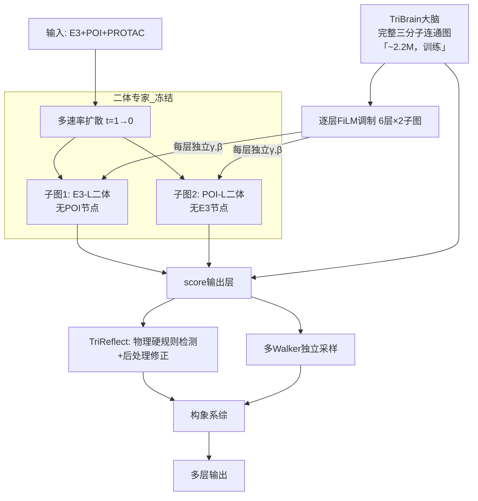

 -h
 # TriCoopDiff: PROTAC三元复合物协同扩散模型 交接文档
> 版本：v2.5 | 最后更新：2026-09-02。本文描述架构；运行方式与数据口径以文档索引中的现行指南为准。
> 模型定位：带物理约束的扩散生成模型，用于 PROTAC 三元复合物结构预测与功能排序。冻结预训练二体专家（DiffDock）+ 轻量协调网络（TriBrain），输入图结构零OOD（内部激活存在 FiLM 调制偏移，消融验证）。同时输出结构系综和功能指标（协同性排序、生产性概率），不声称模拟真实物理动力学

---

## 一、模型概述
### 1.1 解决的核心问题
现有PROTAC对接方法的本质缺陷：
- AlphaFold3/Boltz等结构预测模型只能输出单静态结构，无法建模结合过程和协同性
- 双专家拼接模型参数冗余，无法捕捉真正的三体积协同效应
- 普通二体扩散模型只能建模两两相互作用，会卡在非生产性局部极小
- 分子动力学方法计算成本极高，无法大规模筛选

### 1.2 核心设计哲学
1.  **专业分工，最小侵入**：不重新发明轮子，预训练二体DiffDock作为"专家"负责局部结合，轻量TriBrain作为"协调员"负责全局三体信息。二体专家被拆成两个物理断开的独立子图（E3-L和POI-L），每个子图只含一个蛋白+PROTAC，配体在每个子图里只和一个蛋白作用，**输入图结构**与DiffDock预训练时的标准蛋白-配体对接100%一致。TriBrain通过逐层FiLM调制二体专家的内部激活分布（ControlNet/DiT范式，每层独立head，零初始化保证初始透明），不修改专家的任何参数。消融实验将验证FiLM调制是否导致二体能力退化
2.  **多速率扩散（工程trick）**：不同自由度使用不同噪声衰减速率——PROTAC 快、E3-POI 刚体运动慢。这是经验性的噪声调度策略，三行代码实现。消融实验将验证多速率 vs 单速率是否有实际增益。注意：扩散模型的 `t` 是噪声 schedule 参数，不是物理时间；λ 的阶跃式定义在 threshold 处不可导，是工程近似而非严格的 SDE 推导
3.  **会犯错也会改错**：借鉴扩散语言模型的自我纠正能力，模型不需要一次生成对，支持局部重采样修正错误
4.  **参数高效**：20M 参数来自预训练二体专家（冻结），~2.2M 参数为新增可训练参数（TriBrain）。TriBrain 在数千通用三元复合物上学习协调能力，~50 个 PROTAC 结构用于迁移微调。提供两个版本：通用三元训练的 zero-shot 版本 + PROTAC 微调版本（主推）
5.  **先验分层利用**：PROTAC 设计中通常已知 warhead 结合口袋——确定性高的信息（口袋位置）作为扩散引导势（强约束、随时间衰减），确定性中的信息（关键残基）作为网络特征（弱提示），不确定性高的（精确 pose）不做硬约束。无先验时引导自动归零，优雅退化为 blind diffusion。这是模型在实际场景中能打过传统 pocket-restricted docking 的关键

### 1.3 和现有方法的本质区别
| 方法 | 参数规模 | 三体效应 | 动态过程 | 小数据适配 |
|------|---------|---------|---------|-----------|
| AlphaFold3 | >100M | 隐式 | ❌ 单结构 | ❌ 零样本泛化差 |
| 双专家拼接 | ~40M | ❌ 后融合 | ❌ 单结构 | ❌ 易过拟合 |
| 普通三扩散 | ~20M | ⚠️ 两体加和 | ⚠️ 单速率 | ⚠️ 需要微调 |
| TriCoopDiff | 20M冻结+~2.2M可训 | ✅ 显式三体积 | ✅ 多速率trick+物理后处理 | ✅ 数千通用三元预训练+50 PROTAC微调（FT版主推） |

---

## 二、完整架构说明
### 2.1 模块总览

> MVP 架构：逐层 FiLM（DiT adaLN-Zero 范式，~500k 参数，6 层独立 head，两个子图各一套）。二体专家两个子图物理断开，TriBrain 调制所有层特征。高阶注入方案（边门控、交叉注意力）留作消融升级点。

---

### 2.2 模块1：二体DiffDock专家（冻结）

> **核心约束：二体专家的两个子图物理断开，配体在每个子图里只和一个蛋白作用，输入图结构零OOD（内部激活存在 FiLM 调制偏移，标注为待验证假设）。**

| 项目 | 说明 |
|------|------|
| 基础模型 | DiffDock-L v1.1，20M参数，PDBBind预训练权重 |
| 冻结策略 | 所有层100%冻结，不接收梯度，不做任何微调 |
| 构图策略 | 构造两个**完全不连通**的独立子图，分别前向：<br>**子图1（E3-L二体）**：节点仅含E3残基 + PROTAC原子，边仅含E3内边 + PROTAC内边 + E3-PROTAC边，**完全没有POI节点**<br>**子图2（POI-L二体）**：节点仅含POI残基 + PROTAC原子，边仅含POI内边 + PROTAC内边 + POI-PROTAC边，**完全没有E3节点**<br>两个子图没有直接蛋白-蛋白边，也没有通过配体的间接桥接（配体在每个子图里只和一个蛋白作用），图结构、节点分布、消息传递路径与DiffDock预训练时的标准蛋白-配体对接输入100%一致 |
| 输入 | 两个独立子图分别输入，当前扩散步噪声坐标 |
| 输出 | **子图1输出**：E3-L二体score（PROTAC平移/旋转/二面角score，纯二体水平）<br>**子图2输出**：POI-L二体score（POI平移/旋转score，纯二体水平）<br>两个输出均来自100%预训练原生推理，无任何OOD导致的偏差 |
| 修改点 | 无。不修改DiffDock一行源码，只是把一整个三分子图拆成两个标准蛋白-配体对分别前向，输入格式和官方推理完全一致 |

> **为什么输入图结构零OOD？** 没有直接的蛋白-蛋白边 → 没有通过配体的间接桥接（配体从不接触两个蛋白）→ 两个子图物理断开 → 图结构、节点分布、消息传递路径和DiffDock预训练时100%一致。二体专家就是在一个batch里跑两个独立的标准蛋白-配体对接，这正是它训练了几百万次、最擅长的事情。注：FiLM调制会改变内部激活分布（标准ControlNet/LoRA范式），消融实验将验证这对二体能力是否有影响。

> **计算量**：两个子图的总节点数 = (E3 + L) + (POI + L) = E3 + POI + 2L。PROTAC只有几十个原子，相比两个蛋白的上千个残基，额外计算量可忽略不计。

---

### 2.3 模块2：TriBrain大脑（唯一训练模块）
总参数量：~2.2M（Transformer 1.1M + 几何裁判头 250k + 状态协调头 250k + 逐层FiLM头 500k + 池化 66k），所有参数从头训练，小学习率

> **容量风险与升级路径**：当前配置（3层、单头、32标量+4向量通道、128维瓶颈）对同时做"特征提取+全局协调+多任务输出"来说偏紧。如果效果不够，升级路径：**MVP 3层32通道 → 升级版 6层64通道，参数 ~2.2M → ~5M。** 二体专家冻结了 20M，TriBrain 多几百万参数完全可以接受。先跑 MVP 看效果，不够再加——不在设计阶段过度优化容量。

> TriBrain构建在**独立的完整三分子连通图**上，包含所有节点（E3+POI+PROTAC）和所有边（蛋白内边、蛋白-配体边、**E3-POI蛋白-蛋白边**）。二体专家图中被刻意物理断开的跨分子连接，在这里正是TriBrain的核心信息通道。TriBrain从头训练，不存在OOD问题。

> **多尺度池化——具体实现**（此前多轮模糊，现定死）：
> 
> ```
> 近程池化（<20Å，原子级）：注意力池化 per node → [N_near, 64]
>   - 每个节点用 learned query 聚合 20Å 内的邻居节点特征
>   - 输出 64 维 per node，节点数 ~50-150（随扩散阶段变化）
> 
> 中程池化（<50Å，残基级）：Cα粗粒化 + 注意力池化 → [N_mid, 64]
>   - 先用残基 Cα 代理（每个残基一个节点），再对粗粒化节点做注意力池化
>   - 输出 64 维 per residue，残基数 ~100-300
> 
> 全局池化（所有节点）：平均池化 + 最大池化 concat → [1, 64]
>   - 全局统计量，1 个向量，64 维
> 
> 三路 → Transformer：
>   近程 & 中程 → 直接作为 token 序列
>   全局 [1,64] → 复制拼接到每个 token → 每个 token 128 维
>   + Laplacian PE（基于Cα距离）→ 输入Transformer
> 
> 总参数：~66k（两个注意力池化的 query projection）
> ```
> 多尺度池化确保 TriBrain 在所有扩散阶段都有非空输入：早期全局粗粒度，中期中程残基级，晚期近程原子级。

> **TriBrain 输入特征**（独立原始特征，不依赖二体专家）：残基级 one-hot 氨基酸类型 + 二级结构（DSSP）+ Cα 坐标；原子级元素类型 + vdW 半径 + Gasteiger 部分电荷 + 坐标。边特征：Cα 距离、序列间距、是否共价键。L2 先验知识（关键残基标记 + 理化性质）拼接为额外标量通道。TriBrain 从头学习特征提取，和二体专家完全独立。

> **协调方式**：TriBrain 看到完整的三分子信息后，分别给两个独立的二体子图注入对应的调制参数。二体专家永远不知道另一个蛋白的存在，只是按照 TriBrain 给的 FiLM 参数调整自己的输出。

| 子模块 | 结构 | 参数量 | 输入 | 输出 |
|--------|------|--------|------|------|
| 多尺度池化层 | **近程**（<20Å）、**中程**（<50Å）、**全局**（所有节点）三路池化拼接 | ~66k | 三分子全图节点特征 | 三尺度拼接特征，扩散全程非空输入 |
| 等变Transformer | MVP: 3层，单头交叉注意力，32标量+4向量通道（设计依据：参考EquiDock/GVP的轻量配置，兼顾效率和容量）。升级: 6层，64通道 | 1.1M (MVP) / ~4M (升级) | 池化后的token序列（每token 128维）+ 扩散时间步嵌入 | 界面全局三分子特征 |
| 几何裁判头 | 2层MLP，隐藏层64 | 250k | Transformer输出、当前坐标 | 冲突掩码、置信度、重加噪掩码 |
| 状态协调头 | 2层MLP，隐藏层64 | 250k | Transformer输出、刚体状态 | 结合阶段、生产性概率、ΔΔG自由能 |
| 注入参数头（MVP: 逐层FiLM，DiT范式） | 共享MLP(128→256→256) + 6层×2子图独立Linear(256→d_l×2) | ~500k | Transformer输出 → h_cond [256] | **每层独立γ,β，子图间不对称。** 共享条件嵌入 + 12 个独立投影头（6层×2子图），零初始化。高阶升级：边门控（L2）、交叉注意力（L3） |

**先验知识输入——分层利用：从弱特征到强约束**：

> PROTAC 设计中通常已知 warhead 的结合位点信息（共晶结构、SAR数据）。如果不系统性地利用这些强先验来缩小搜索空间，模型在实用性上无法与传统 pocket-restricted docking 竞争。核心原则：**确定性越高的信息，约束越强；不确定性高的，退化为弱特征。**

| 层次 | 信息内容 | 确定性 | 在模型中的角色 | 具体编码方式 |
|------|---------|--------|--------------|-------------|
| **L1：口袋级约束** | warhead A 结合在 E3 的哪个口袋（如 VHL 的 hydroxyproline 口袋）、warhead B 结合在 POI 的哪个口袋；口袋关键残基索引及重要性权重 | 通常确定 | **扩散引导势**（强约束）：口袋引导 score `s_pocket`，早期将 warhead 拉到口袋附近，后期衰减让物理模型精细调整 | 口袋残基 Cα 加权质心 + 残基重要性权重 → 构建距离梯度势（见 3.5 节） |
| **L2：接触级特征** | 口袋中与 warhead 形成关键相互作用的残基（氢键供体/受体、疏水堆积位点） | 较确定 | **节点/边特征**（弱提示）：注入为 TriBrain Transformer 的附加节点特征通道，帮助注意力和全局推理 | 关键残基 one-hot 标记 + 理化性质（氢键能力、疏水性、电荷）作为额外标量通道 |
| **L3：构象级约束** | warhead 在口袋中的精确 binding pose（共晶结构中的配体构象） | 部分已知（linker 连接后可能微调） | **可选弱约束**：如果已知，可用于初始化或作为 weak distance restraint；不影响最终精细搜索 | 共晶 pose 中的 warhead 原子坐标 → 可选的距离上限约束（flat-bottom potential） |
| **无先验退化** | 全新 E3 配体、无共晶结构 | — | 所有引导系数 α=0，模型自动退化为完全无引导的 blind diffusion | 不需要任何修改，架构天然支持 |

> **为什么分层？** 如果把所有先验都编码为同一强度的特征，要么浪费强先验（口袋已知却不缩小搜索空间），要么过度依赖弱先验（构象不确定却硬约束）。分层让模型对确定的信息充分利用、对不确定的信息保持灵活。

**生产性构象的精确定义**（此前模糊，现定死）：

> 生产性构象 = 能发生泛素转移反应的三元复合物构象。满足以下 3 条的构象标记为"生产性"：

| 条件 | 标准 | 依据 |
|------|------|------|
| **赖氨酸距离** | POI 泛素化赖氨酸 Cα → E2 活性位点 Cys Cα 距离 < 15Å | 泛素从 E2 转移到赖氨酸 ε-氨基需要空间邻近。泛素 tail 完全伸展 ~15Å，这是可达范围上界 |
| **赖氨酸朝向** | 赖氨酸 ε-氨基 Nζ 指向 E2 方向：Nζ-Cys 向量与 Cα-Cβ 向量夹角 > 90° | 泛素转移需要赖氨酸侧链面向 E2 活性位点，而非背离。90° 判别侧链朝向 |
| **溶剂可及性** | 赖氨酸 ε-氨基的 SASA > 10 Ų | 赖氨酸必须暴露才能被泛素化，埋藏在蛋白内部的赖氨酸不可被修饰 |

> 系综中满足全部 3 条的构象占比 = **生产性概率**。这一定义来自泛素化机制的化学生物学文献，可在论文中引用（泛素转移空间化学要求）。

**硬编码先验（始终需要的少量信息）**：
- PROTAC 两个 warhead 原子索引、linker 可旋转键索引
- POI 上泛素化赖氨酸残基索引（用于生产性引导，见 3.5 节）
- E3 上 E2 结合位点参考位置（用于生产性引导）

---

### 2.4 模块3：逐层 FiLM 条件调制（ControlNet/DiT 范式）

> **设计依据**：CV 领域条件生成模型（DiT、ControlNet、Stable Diffusion）的共识——条件信号必须注入到所有层级。逐层独立 FiLM 在 DiT adaLN-Zero 中被充分验证：冻结基座权重，零初始化调制层，训练起点等价于原始模型。我们做的事和 ControlNet 完全一致：不修改 DiffDock 权重，在其周围构建条件调制外壳。

#### 2.4.1 MVP：逐层独立 FiLM（每层独立 head，权重不共享）

```
DiffDock 子图前向（以E3-L为例，POI-L对称）:

Conv1 → h1 ──→ FiLM_1(γ1_e3l, β1_e3l) → h1'
Conv2 → h2 ──→ FiLM_2(γ2_e3l, β2_e3l) → h2'
Conv3 → h3 ──→ FiLM_3(γ3_e3l, β3_e3l) → h3'
Conv4 → h4 ──→ FiLM_4(γ4_e3l, β4_e3l) → h4'
Conv5 → h5 ──→ FiLM_5(γ5_e3l, β5_e3l) → h5'
Conv6 → h6 ──→ FiLM_6(γ6_e3l, β6_e3l) → h6'  → score heads

每个 FiLM 调制: h'_l = h_l * (1 + γ_l) + β_l
每个 γ_l, β_l 维度 = d_f（该层输出特征维度）
```

**FiLM 参数生成（DiT adaLN-Zero 范式）**：

```
TriBrain → h_tri [128]（等变Transformer全局池化）
           │
           ├→ FiLM_shared: Linear(128→256)→SiLU→Linear(256→256) → h_cond [256]
           │                                                       [共享，~99k参数]
           │
           ├→ head_e3l_1: Linear(256→d1*2) → (γ1_e3l, β1_e3l)    [独立权重]
           ├→ head_e3l_2: Linear(256→d2*2) → (γ2_e3l, β2_e3l)
           ├→ head_e3l_3: Linear(256→d3*2) → (γ3_e3l, β3_e3l)
           ├→ head_e3l_4: Linear(256→d4*2) → (γ4_e3l, β4_e3l)
           ├→ head_e3l_5: Linear(256→d5*2) → (γ5_e3l, β5_e3l)
           ├→ head_e3l_6: Linear(256→d6*2) → (γ6_e3l, β6_e3l)
           │
           └→ head_pol_{1..6}: 对POI-L子图独立一组6个head [对称结构]
```

> **关键设计决策（参考 CV 实践）**：①每层独立 head（权重不共享）——不同层代表不同抽象级别，浅层是几何/边特征、中层是局部相互作用、深层是全局 pose。同一个 γ/β 作用于所有层是矛盾的；②两个子图各有一套独立 head——E3 和 POI 的化学环境不同，需要非对称调制；③零初始化所有 head（γ=0, β=0），初始完全透明。

| 参数 | 值 | 说明 |
|------|-----|------|
| 共享 MLP | Linear(128→256)→SiLU→Linear(256→256) | ~99k，所有 head 共享条件嵌入 |
| 每层 head | Linear(256→d_l×2)，d_l 为该层输出维度 | ~33k/head，6层×2子图=12个head≈400k |
| FiLM 总参数 | ~500k | TriBrain 注入参数头的新预算 |
| 初始化 | 所有 γ=0, β=0 | 零初始化，训练初始等价于不加 FiLM |
| 每通道独立 | `h'[i] = h[i]*(1+γ[i]) + β[i]` | 128 个通道各有独立的 γ_i 和 β_i |

#### 2.4.2 消融升级路径

| 消融级别 | 注入方案 | 参数量 | 说明 |
|---------|---------|--------|------|
| **L0（无注入）** | 纯二体 score + TriBrain 残差 score | 0 | 消融基线：验证调制是否必要 |
| **L0.5** | 单层瓶颈 FiLM（L6 only，一层MLP） | ~100k | 验证"注入层级越多越好" |
| **L1（MVP）** | 逐层独立 FiLM（全6层，DiT范式） | ~500k | 当前默认方案 |
| **L2** | L1 + 边门控（L1-L4，距离<10Å边） | +200k | 边级细粒度调制 |
| **L3** | L2 + 交叉注意力（最终score层） | +200k | 长程E3-POI信息显式注入 |

> **核心消融**：L0→L0.5→L1 验证 CV 共识——"注入层级越多效果越好"。有 DiT/ControlNet 支撑。

#### 2.4.3 消融实验层次（明确优先级，防止实验量爆炸）

**核心消融（必须做，在 MVP 基础上，控制 6 个以内）**：

| # | 消融 | 基础 | 验证问题 |
|---|------|------|---------|
| A | L0（无 FiLM）vs L1（逐层 FiLM） | MVP | FiLM 调制是否必要？ |
| B | 加和 vs Score 协调层 | MVP | 加和假设是否成立？ |
| C | 单速率 vs 多速率 | MVP | 多速率 trick 是否有增益？ |
| D | 口袋引导 有 vs 无 | MVP | 引导是否提升搜索效率？ |
| E | TriReflect 有 vs 无 | MVP | 后处理修正是否降低硬错误率？ |
| F | 原始特征 vs +二体专家特征 | MVP | TriBrain 独立特征是否够用？ |

**补充消融（可选，实验资源允许时做）**：

| # | 消融 | 基础 | 验证问题 |
|---|------|------|---------|
| G | 注入级别 L1→L2→L3 | 完整版 | 边门控/交叉注意力是否有累积增益？ |
| H | TriReflect L1→L2 | 完整版 | In-sampling 重采样是否优于后处理？ |
| I | 多速率 2流 vs 3流 | 完整版 | 分离平移/旋转速率是否有额外增益？ |

> 核心消融 ~6 个实验，每个跑一次完整训练+评估。补充消融只在核心消融全部完成、且 MVP 效果达标后做。防止实验量爆炸。

### 2.5 Score组成

**MVP score 分解（逐层 FiLM + residual gate）**：
```
PROTAC score = s_q1 + g · (s_q2 - s_q1) + pocket guidance
POI rigid score = TriBrain SE(3) head
```

> FiLM 调制作用于二体专家每一层 Conv 输出。MergeGateHead 的权重与 bias 均为零初始化，所以训练起点 `g=0`、`s_q=s_q1`，严格保留 E3-L expert；训练后才逐步引入 POI-L 修正。sub2 的 tr/rot 在合并前旋回 E3 frame，torsion 不随参考系旋转。口袋引导是独立的物理引导项。

**一个直观的协调例子**：
- 二体专家独立计算：子图1中E3对PROTAC有向E3口袋的1Å拉力；子图2中POI对PROTAC有向POI口袋的1Å拉力。两个子图互不知情，方向相反，加起来linker断裂
- TriBrain看到全局：发现两个拉力加起来linker超伸 → FiLM逐层调制子图1特征（×0.5），子图2特征（×0.5），让两个拉力都降到0.5Å；同时输出一个让两个蛋白靠近0.2Å的E3-POI刚体score
- 最终结果：PROTAC停在两个口袋中间，两个蛋白距离合理，linker张力刚好，三分子平衡——二体专家从头到尾不知道另一个蛋白的存在

### 2.6 PROTAC 坐标同步机制

两个子图物理断开，但共享 PROTAC 配体。每步扩散中两个子图各自输出 PROTAC 的 score → 合并 → 更新：

```
子图1 (E3-L): 前向 → s_q1 (PROTAC平移/旋转/二面角score，相对E3)
子图2 (POI-L): 前向 → s_q2 (PROTAC平移/旋转/二面角score，相对POI)

合并: s_q = s_q1 + g * (s_q2 - s_q1)  # g 由 TriBrain 预测，零初始化
更新: q(t-Δt) = q(t) + λ_q² · (s_q + s_guide_q) · Δt
```

> 直接相加会在零 FiLM 时把两个 expert score 双重计数，破坏 native baseline。Residual gate 同时提供 score 级协调和透明初始化；`use_learned_merge=False` 的直接加和只保留为消融。

### 2.7 关键假设与未验证问题（诚实标注）

> 以下假设是当前架构设计的基础，需要在实现过程中通过实验验证。它们不是"设计缺陷"而是"待验证的前提"。

| 假设 | 风险 | 验证方式 |
|------|------|---------|
| **Residual score 可学习**：`s_q2-s_q1` 能表达 POI 条件修正 | 两个 expert score 高度相关或尺度不同 | 监控 merge gate、分支 score 范数和完整模型消融 |
| **扩散系综 ≈ 玻尔兹曼分布**：扩散采样得到的构象分布与真实热力学分布定性一致 | 扩散模型学的是训练数据分布，非平衡态分布 | 在已知 PROTAC 体系上对比采样分布和 MD 轨迹的布居比 → 定性比较 |
| **通用三元→PROTAC 迁移**：通用三元学习的协调能力可迁移到 PROTAC | 几何特征差异大（配体大小、界面尺度、linker 角色） | 阶段1后在 PROTAC benchmark 上做 zero-shot 评估 → 如果效果差，重点放在 FT 版本 |
| **零 OOD 与三体协调的平衡**：FiLM 调制越强 → 三体协调越好 → 但二体专家偏离预训练模式越多 | 存在最优注入强度，太强/太弱都不好 | 消融：不同 FiLM 初始化缩放因子 → 找到最优范围 |
| **口袋引导不显著偏移采样分布**：α·t 衰减下，早期引导对最终分布的影响可接受 | 早期引导改变轨迹，t=0 时引导为零不代表分布未受影响 | 消融：有/无引导下最终系综的布居差异 → 定量评估偏移 |

### 2.8 失败模式与 Plan B

> 每个关键假设都对应一个"如果失败了怎么办"。这不是悲观，是工程纪律。

| 失败场景 | 可能性 | 影响 | Plan B |
|---------|--------|------|--------|
| **Score 加和假设不成立** | 中 | PROTAC 的 score 在两个子图间冲突，linker 张力无法协调 | 改为 TriBrain 直接输出 s_q（不经过加和），消融比较两种方案 |
| **通用三元→PROTAC 迁移失败** | 中高 | Zero-shot 版不可用 | 主推 FT 版（~50 PROTAC 微调）；Zero 版降级为"bonus"，不纳入主要宣称 |
| **FiLM 调制导致二体能力退化** | 中低 | 二体专家的结合 pose 精度下降 | 减小 FiLM 初始化缩放因子；或使用更保守的正则化（如 L2 约束 γ,β 的范数） |
| **TriBrain 容量不足** | 中 | 三体协调能力弱，全局特征提取不充分 | 增加 Transformer 深度（3→6 层）或通道数（32→64）；或加入二体专家特征作为额外输入（消融 L0.5→L1） |
| **多速率扩散无增益** | 中 | 额外的工程复杂度没有回报 | 直接去掉，退化为单速率扩散。λ 代码就三行，去掉成本极低 |
| **口袋引导偏移过大** | 中低 | 自由能排序不准 | 对需要精确自由能的场景使用 α→0（等价于无引导）；仅在结构预测场景使用引导 |
| **32 条独立轨迹多样性不足** | 中 | 自由能排序的统计显著性不够 | 增加 walker 数量到 100+；或重新论证复本交换的理论基础并实现 |
| **物理损失量级与 score 损失不匹配** | 中 | 物理损失被忽略或主导训练 | 使用不确定性加权或 GradNorm 自动平衡损失权重；必要时手动调优 |
| **PROTAC 微调过拟合** | 中 | 40 训练样本 → DockQ 虚高 → 泛化差 | 使用强正则化（LoRA、强 weight decay、early stopping）；按 E3 类型划分测试集评估真实泛化 |
| **DeepTernary 审计结果不如预期** | 低 | "物理合理性"叙事支点不成立 | 功能排序（协同性、生产性概率）仍是 DeepTernary 做不了的护城河；叙事重心转移到功能指标 |

---

## 三、扩散过程规范

### 3.1 多速率扩散：工程 trick，非严格物理模型

> **诚实定位**：两个 λ 系数使用 `clamp((t - threshold) / (1 - threshold), min=0)`——在 threshold 处存在阶跃（不可导），这不是标准的多速率 SDE，是一个**经验性的噪声调度 trick**。扩散模型的 `t` 是噪声 schedule 参数，不是物理时间。λ 的取值（0.7/0.5）是经验超参数，需要通过消融实验确定最优值。多速率 vs 单速率的效果由消融实验验证——如果无显著增益，可以去掉。

**SDE形式**（VP-SDE，与原DiffDock一致）：
```
dx = -1/2 β(t) x dt + √β(t) dw    （标准形式，所有自由度共享同一个时间t）
```

**多速率体现在加噪和去噪时的自由度缩放**：
```python
# 全局时间t从1（全噪声）到0（干净），所有自由度共享
# 两个噪声衰减系数
lambda_q   = torch.clamp((t - 0.7) / (1.0 - 0.7), min=0)   # PROTAC快，t=0.7到0
lambda_SE3 = torch.clamp((t - 0.5) / (1.0 - 0.5), min=0)   # E3-POI刚体慢，t=0.5到0
# 注：如需区分平移和旋转的收敛速率 → 可拆回3流作为消融
```

- **加噪时**：给不同自由度的噪声乘以对应的 λ，噪声系数越大该自由度噪声越多、越不确定
- **去噪时**：每个自由度的更新步长乘以对应的 λ²，λ 小的更新小（仍不确定）、λ 大的更新大（趋于收敛）

---

### 3.2 两类自由度的score归属：天然解耦，各出各的

**两个score本来就是不同模块的自然输出，不需要在一个网络里解耦**：

| 自由度 | 符号 | Score来源 | 说明 |
|--------|------|----------|------|
| PROTAC平移/旋转/二面角 | **s_q** | **DiffDock二体专家原生输出 + FiLM调制** | DiffDock输出原始配体score，TriBrain通过逐层FiLM调制其上游特征来调整score的强度和方向。调制后的s_q已在合并前消除了三体冲突 |
| E3-POI刚体运动 | **s_SE3**（6维：3平移+3旋转 in so(3)） | **TriBrain原生输出** | 二体专家蛋白是固定的，E3-POI刚体运动的 score 从头就是 TriBrain 的职责。标准 SE(3) 参数化，不拆成距离/旋转两个标量——拆分会引入物理上不自然的参数化偏差 |

**前向流程（一次前向，无额外计算量）**：
```
输入: 当前坐标 x(t), 全局时间 t
  │
  ├─→ DiffDock二体专家(t, x)  ──→  s_q（PROTAC配体score）
  │
  ├─→ TriBrain(t, x)  ──→  s_SE3（E3-POI刚体6维SE(3) score）+ 注入参数调制s_q
  │
  ├─→ 口袋引导(t, x)  ──→  s_guide（解析梯度，非网络输出，详见3.5节）
  │
  └─→ 最终score = {s_q(调制后), s_SE3, s_guide}
  │
更新步骤（多速率 + 引导）:
  q(t-Δt)     = q(t) + λ_q² · (s_q + s_guide_q) · Δt      # PROTAC更新：网络score + 口袋引导
  SE3(t-Δt)   = SE3(t) + λ_SE3² · s_SE3 · Δt             # E3-POI刚体更新（6维SE(3) score）
```

---

### 3.3 多速率噪声schedule

两类自由度全程**并行更新**（不是串行阶段），不同 λ 衰减速率导致在不同阶段收敛：

| 自由度 | λ衰减区间 | 动机 |
|--------|-----------|------|
| q：PROTAC内部自由度（平移/旋转/二面角） | t=1.0→0.7，λ_q最快归零 | PROTAC 原子少、灵活，先定大方向 |
| SE3：E3-POI刚体运动（6维，3平移+3旋转） | t=0.5→0.0，λ_SE3中慢速归零 | 蛋白笨重，刚体运动收敛比小分子慢 |

> λ 的具体取值（0.7/0.5）是经验超参数，需要通过消融实验确定。多速率 vs 单速率的效果将通过消融实验验证。

---

### 3.4 基础扩散参数

- 扩散总步数：20步（ODE求解，与DiffDock一致，保证速度）
- 噪声调度基础形式：VP-SDE，与原DiffDock一致
- 全局时间：t ∈ [1, 0]，所有模块共享同一个t，一次前向
- 计算量：与单速率扩散完全一致，无任何增加

### 3.5 口袋引导：用已知结合位点信息缩小搜索空间

> **动机**：PROTAC 设计中通常已知 warhead 的结合口袋（来自 E3 配体共晶结构和 POI 抑制剂共晶结构）。如果不利用这些强先验，模型需要在蛋白全表面搜索 warhead 的结合位置——这是 10¹ 量级难度的不必要的浪费，传统 pocket-restricted docking 之所以快，就是因为把搜索空间锁死在口袋附近。但传统方法无法处理 linker 协调和三体协同——我们保留这些能力的同时，用先验把二体搜索的难度降下来。

#### 3.5.1 设计原则

**核心：引导是物理势，不是网络输出。随扩散时间衰减。无先验时自动退化。**

```
原则1：引导只作用于已知的、确定性高的信息（口袋位置）
原则2：引导强度 ∝ t（扩散时间），早期强 → 晚期弱 → t=0 时完全消失
原则3：引导是加性偏置（加到 score 上），不影响网络本身的输出
原则4：无先验时 α=0，模型自动退化为完全无引导的 blind diffusion
```

#### 3.5.2 三种引导势

**引导 1：E3 口袋引导（最强，确定性最高）**

```python
# 口袋残基Cα的加权质心（关键残基权重高，周边残基权重低）
e3_pocket_center = Σ(w_i * cα_i) / Σw_i  for i in pocket_residues
# warhead A 重原子到口袋质心的平均距离
dist_e3 = mean(||warhead_A_atoms - e3_pocket_center||, dim=-1)
# 引导score：指向口袋质心的单位向量 × 引导强度
s_guide_e3 = -alpha_e3 * t * (warhead_A_atoms - e3_pocket_center) / (dist_e3 + eps)
```

**引导 2：POI 口袋引导（最强，确定性最高）**
```python
# 完全对称的结构
poi_pocket_center = Σ(w_j * cα_j) / Σw_j  for j in pocket_residues
dist_poi = mean(||warhead_B_atoms - poi_pocket_center||, dim=-1)
s_guide_poi = -alpha_poi * t * (warhead_B_atoms - poi_pocket_center) / (dist_poi + eps)
```

**引导 3：生产性几何引导（较弱，只是偏好不是硬约束）**

```python
# POI 泛素化赖氨酸 Cα → E2 活性位点 Cys 的参考位置
# 不需要精确对准，只需要大致方向偏好
s_guide_productive = -alpha_prod * t * (lysine_ca - e2_active_site_ref) / (dist_lys_e2 + eps)
```

#### 3.5.3 引导强度调度

| 参数 | 推荐值 | 说明 |
|------|--------|------|
| `alpha_e3` | 1.0 | E3 口袋引导强度，已知口袋时可用较高值 |
| `alpha_poi` | 1.0 | POI 口袋引导强度 |
| `alpha_prod` | 0.3 | 生产性引导强度，较弱以避免过度约束 |
| 衰减方式 | 线性：`× t` | t=1 全强度，t=0 零强度。也可用 `t²` 让衰减更快 |
| 无先验时 | `alpha_* = 0` | 所有引导项归零，等价于标准 blind diffusion |

> **`× t` 衰减的分布偏移问题**：口袋引导等价于在采样分布中引入偏置项 exp(-V_pocket(x))。t=0 时引导为零不代表最终分布不受影响——早期引导改变了扩散轨迹。

> **引导与自由能计算的互斥（不是 bug，是 feature）**：引导势是加性偏置，偏置改变采样分布。精确自由能计算要求采样分布尽可能接近真实玻尔兹曼分布。这两个目标本质互斥——加引导提高搜索效率但牺牲分布精度。**解决方案是场景切换**：结构预测场景用引导（α>0），快速锁定口袋，输出几何合理的结构；自由能排序场景关闭引导（α=0），用纯物理 score 采样，保证分布无偏。同一模型，不同设置——不需要在引导和自由能之间找折中，直接分场景使用。

#### 3.5.4 对搜索空间的影响

| 方法 | 搜索空间 | 口袋信息利用 |
|------|---------|-------------|
| 传统 pocket-restricted docking | 口袋附近盒子（~10³ ų） | 硬约束，盒子外完全不搜索 |
| AlphaFold3 | 整个蛋白表面 | 隐式，通过 MSA 间接编码 |
| 原 TriCoopDiff（无引导） | 整个蛋白表面（所有自由度从噪声开始） | L2 接触级当弱特征 |
| **TriCoopDiff + 口袋引导** | 早期引导到口袋 → 晚期在口袋附近精细搜索 + 全局协调 linker 和蛋白取向 | **显式引导势，强→弱退火** |

> 加了口袋引导后，模型从"大海捞针"变成"飞镖盘上找靶心"——搜素难度降两个数量级，但保留了其他方法没有的能力（linker 张力协调、三体协同、生产性构象引导）。

---

## 四、采样算法规范

### 4.1 TriReflect 物理合理性修正

> **核心原则：错误检测和错误修复完全解耦。物理规则当裁判，模型当修理工。** TriReflect 只纠正物理上不可能存在的硬错误（穿模、断键、linker 张力过大），不纠正"软错误"（结合模式好不好、是不是生产性构象）。

> **TriReflect 的诚实边界——它能做什么、不能做什么**：
> - ✅ 能做：检测和修正原子级硬物理错误，保证输出结构没有明显的物理伤
> - ❌ 不能做：判断结合模式是否正确、构象是不是生产性的、自由能排序——这些是正常的自由能盆地差异，不是"错误"
> - ❌ 不能做：大幅改变 linker 走向或蛋白取向——后处理式修正是小幅局部优化，初始构象如果已经塌缩到局部极小，后处理拉不回来
> - ⚠️ 软错误的代价：扩散模型最常见的失败模式可能是结合模式错了但物理上完全合理——这种失败 TriReflect 检测不到、也修不了。依赖的是 diffusion + FiLM 的生成质量，不是 TriReflect。

#### 4.1.1 MVP 方案：后处理式修正

**MVP 采用最简单的方案：扩散结束后，物理模块检测硬错误 → 局部能量最小化修正。** 不嵌入扩散过程中，避免"局部重加噪是否破坏扩散一致性"的理论问题。

```
扩散流程 (t=1→0):
  1. 正常多速率扩散 20 步（二体专家 + TriBrain → score → 更新）
  2. 扩散结束 (t=0)

后处理修正:
  3. [物理模块] 全局硬错误检测（纯规则，零网络参与）
     - 穿模检测 → 标记冲突原子对
     - 断键检测 → 标记异常共价键
     - Linker 高能检测 → 标记异常二面角
  4. if 无硬错误 → 输出最终构象
     else → 对错误区域做局部能量最小化（MMFF94力场，最多3轮）
         → 修正后重新检测
         → if 仍有不可修复的错误 → 标记该构象为"物理不合理"（作为质量指标输出）
```

| 参数 | 默认值 | 说明 |
|------|--------|------|
| 冲突阈值 | 距离 < vdW 半径和 × 0.7 | vdW 半径取自 Bondi 标准值 |
| Linker 张力阈值 | 键能 > 5 kcal/mol | MMFF94 快速力场估算 |
| 最大修正轮数 | 3 | 每轮步长递减 |
| 不可修复标记 | 3 轮后仍有硬错误 | 在系综分析中降低该构象的权重或直接丢弃 |

#### 4.1.2 消融升级：In-Sampling 局部重采样

后处理修正的问题是：只能在已有构象上做小幅度修正，无法大幅改变 linker 走向或蛋白取向。如果后处理效果不够，升级为在扩散过程中嵌入重采样（类比 RePaint 的已知区域保持 + 未知区域重加噪）：

```
消融级别:
  L0: 无 TriReflect（纯扩散输出）
  L1 (MVP): 后处理修正（扩散结束后物理检测 + 局部能量最小化）
  L2: L1 + 每 5 步检测 + 对错误自由度局部重加噪（RePaint 式）
```

> L2 需要论证的关键问题：按自由度（而非空间区域）拆分重加噪在扩散框架下的分布一致性。MVP 阶段先做 L1，L1 的消融结果（冲突率是否下降、DockQ 是否提升）决定了是否需要 L2。

#### 4.1.3 错误检测：无参数硬规则（独立物理模块）

| 检测项 | 判定规则 | 计算方式 |
|--------|---------|---------|
| **空间冲突（穿模）** | 非键合原子对距离 < vdW 半径和 × 0.7 | 纯几何：KD-tree 加速，O(N log N) |
| **共价键断裂** | 键长 > 标准键长 × 1.5 或键角偏离 > 40° | 纯几何：检查 PROTAC 分子内键长键角列表 |
| **Linker 高能** | 二面角 eclipsed（\|二面角\| < 30° 或 > 150°）或键角张力 > 5 kcal/mol | MMFF94 单点能量扫描，O(K) |

> 物理规则零参数零偏差，永远不会"自己骗自己"。不需要训练、不需要网络、比任何学习到的裁判都准确。

---

### 4.2 多Walker独立采样（复本交换为实验性可选升级）

> **基础方案：32 条独立扩散轨迹。** 这是最朴素的多样性策略——不同随机 seed → 不同去噪路径 → 不同的最终构象。32 条轨迹完全独立，没有交换机制，实现简单、理论基础清楚。

| 参数 | 默认值 | 说明 |
|------|--------|------|
| Walker 数量 | 32（α 预测场景可能需要 100+） | 独立随机 seed，并行去噪 |
| 最终系综 | 所有 walker 去噪结束后的构象集合 | 自由能排序从系综布居比估计 |

> **实验性升级：复本交换。** 理论基础存在多个未解决的问题——score scaling ≠ 温度 scaling（温度影响噪声项而非 drift 项）、扩散轨迹不是平衡态采样（复本交换是平衡态 MCMC 方法）、"能量"定义与 score 的关系不明确（score = -∇E 只在 score 对应真实势能梯度时成立）。**MVP 中不包含复本交换，32 条独立轨迹已提供基本多样性。** 如果消融实验表明独立采样不够（构象多样性不足、自由能排序不准），再考虑实现复本交换并论证其有效性。此时需明确：
- "温度"→ score × 温度因子的经验性定义
- 物理能量作为交换判据的经验性近似
- 不做"和 MD 同构"的物理声明

---

## 五、训练方案

> **核心判断**：TriBrain 需要学习的核心能力——"协调两个独立二体对接、平衡 linker 张力、调整刚体姿态"——如果能从通用三元复合物学到，则不需要 PROTAC 特有数据。但通用三元复合物的实际可用数量和质量需要在训练前先验证。以下数字为预估值，非确定事实。

### 数据规模分析

| 数据来源 | 预估规模 | **验证状态** | 用于训练什么 |
|---------|---------|------------|-------------|
| PDB 通用三元复合物 | **预估 2000-5000，需先验证** | ⚠️ 需在实现前跑 PDB 查询确认：真正"配体桥接两个蛋白"的结构有多少？配体大小分布如何？如果实际 < 1000 或大部分配体太小（<20 重原子），需调整策略 | TriBrain 的核心通用能力：协调、几何常识、物理约束 |
| PDB PROTAC 三元复合物 | ~50 个 | PROTAC 特有的化学环境（E3 口袋化学、warhead 类型、linker 化学）、生产性几何约束 | 迁移到 PROTAC 体系：E3 界面化学、生产性构象偏好 |
| 实验活性数据 | ~200 个（DC50/α值） | 构象→活性的映射 | 自由能头校准：预测相对活性排序 |

### 两个模型版本

| 版本 | 训练 | 适用场景 | 预期能力 |
|------|------|---------|---------|
| **TriCoopDiff-Zero** | 阶段1（通用三元复合物） | 快速初步筛选，给出三元复合物能否形成的概率排序 | 生成几何合理构象系综，粗筛可形成/不可形成的 PROTAC。注：通用三元→PROTAC的zero-shot泛化存在gap（通用三元配体小、界面大；PROTAC配体大、linker主动协调），需实验验证可行性，不设过高预期 |
| **TriCoopDiff-FT** | 阶段1 → 阶段2（+PROTAC 微调） | 有已知 PROTAC 结构或需要精确预测时 | 精确 RMSD、结合模式、协同性 α 排序、生产性构象概率。这是主推版本 |

---

### 阶段1：通用三元复合物训练（产出 TriCoopDiff-Zero）

- **数据集构建**：从 PDB 中筛选满足以下条件的三元结构：
  - 两条蛋白链 + 一个小分子/肽（**≥20 个重原子**，排除过于微小的配体，确保和 PROTAC 尺度有一定可比性）
  - 配体与两条蛋白链均至少有一个原子在 8Å 以内（确保配体桥接两个蛋白）
  - **配体与两条蛋白的界面埋藏面积均 > 50 Ų**（排除偶然接触，确保配体和两个蛋白都有真实相互作用）
  - 分辨率 < **2.5Å**（保证配体 pose 质量）
  - 按 40% 序列相似度去冗余
  - **⚠️ 预估筛选后 2000-5000 个结构，实际数量需在实现前跑 PDB 查询确认。如果实际 < 1000 或大部分配体 < 50 重原子，需调整训练策略（如降低迁移预期、增加数据增强强度）**
- **数据增强**：随机旋转平移（SE(3)增强）、加噪声生成不同扩散步训练样本、linker 长度扰动（+/- 2 个原子模拟 linker 变化）
- **训练参数**：batch size=32，学习率=1e-4，AdamW 优化器 + 余弦退火，训练 50-100 epoch（大数据下可以充分训练不过拟合）
- **训练目标**：
  - 扩散 score 匹配损失（MSE，权重 1.0）——TriBrain 学协调两个二体对接的核心信号
  - 物理损失（权重 0.5）：空间冲突损失、linker 键长键角损失、共价几何损失
  - SE(3) 刚体一致性损失（权重 0.3）：TriBrain 预测的 E3-POI 刚体 score (6维SE(3)) 与真实结构的刚体变换一致
- **训练范围**：仅训练 TriBrain 和注入层参数（~2.2M），二体专家完全冻结
- **目标**：TriBrain 学会"给定任意两个蛋白和一个桥接配体，协调出几何合理的三元复合物"——这是跨体系通用的能力，不需要 PROTAC 化学知识

> **损失权重说明**：以上所有权重均为初始超参数（非确定值）。不同损失的量级可能差异很大（score 损失 Ų 量级，物理损失 kcal/mol 量级），需要通过验证集调优。建议使用 uncertainty weighting 或 GradNorm 自动平衡。

> **多任务梯度干扰**：TriBrain 的 4 个输出头（几何裁判/状态协调/注入参数/刚体 score）任务性质差异大，共享 backbone 可能存在梯度干扰。建议：**阶段 1-2 冻结几何裁判头和状态协调头**（只训注入参数头和刚体 score 头），阶段 3 再开放裁判头和协调头。分阶段解冻避免早期训练中的多任务冲突。或者使用 GradNorm 动态调整各头 loss 权重。

> **物理损失计算方式与梯度路径**（此前梯度路径有误，现修正）：
> 
> 物理损失只对每步扩散的去噪后坐标计算，不需要通过 20 步 BPTT。**梯度路径**：
> ```
> 物理损失(VDW/键长/二面角) → ∂x_denoised → s_tri_residual → TriBrain
>                                         ↑
>                                    TriBrain直接输出的三体残差score
> ```
> **为什么走 s_tri_residual 而非 FiLM 参数？** 二体专家冻结 → score head 冻结 → 梯度无法通过 score head 回传。通过 FiLM(γ,β) 回传路径太间接（经过 score head 两层 MLP + 特征调制），梯度衰减严重。物理冲突本质是三体协调失败——两个二体 score 各自合理但拼起来打架——应该由 TriBrain 的三体残差 score 直接修正，不是靠减弱二体 score 来掩盖。物理损失直接监督 s_tri_residual，梯度短且干净。

### 阶段2：PROTAC 迁移微调（产出 TriCoopDiff-FT）

- **数据集**：PDB 中所有已解析的 PROTAC 三元复合物结构（~50 个），配合随机旋转平移增强
- **数据划分策略**：做三种划分，分别报告结果，全面评估泛化能力：
  - **随机划分**（8:2）：最简单，但可能高估泛化（同 E3 的不同 PROTAC 可能泄漏到测试集）
  - **按 E3 划分**：训练=CRBN/VHL 中一种，测试=另一种 → 评估对全新 E3 连接酶的泛化
  - **按 POI 家族划分**：训练=激酶，测试=BET 溴结构域等 → 评估对全新靶点家族的泛化
- **训练参数**：batch size=8，学习率=2e-5（极低），余弦退火，训练 30-50 epoch + early stopping（监控验证集 score 匹配损失）
- **训练目标**（在阶段1损失基础上增加）：
  - 生产性几何损失（权重 0.3）：POI 泛素化赖氨酸 Cα 到 E2 活性位点的距离和角度约束
  - E3 特异性化学损失（权重 0.2）：VHL/cereblon 等 E3 连接酶特有的界面相互作用模式匹配
- **训练范围**：仍冻结二体专家，仅微调 TriBrain 和注入层
- **关键正则化**：使用 LoRA 风格的轻量适配（在 TriBrain MLP 层插入低秩适配器，参数量 < 100k），或全参数微调 + 强权重衰减。目的：保留阶段1学到的通用协调能力，只增益 PROTAC 特有的化学知识
- **目标**：在通用协调能力之上叠加 PROTAC 体系的化学特异性，精确预测结合模式和生产性构象

### 阶段3：实验数据对齐（可选，有实验数据时做）

- **数据集**：有实验 DC50/α 值的 PROTAC 数据（~200 个）
- **训练参数**：学习率=1e-5，仅训练状态协调头和几何裁判头（~500k），冻结其余 TriBrain 参数
- **训练目标**：
  - 阶段2 所有损失（权重降低到 0.2，防止灾难性遗忘）
  - 协同性排序损失：TriBrain 预测的 ΔΔG 和实验 α 值排序一致（MarginRankingLoss，权重 1.0）
  - Hook 效应拐点排序损失（权重 0.5）：预测 Hook 效应拐点的相对高低排序
- **目标**：将自由能头的输出校准到实验活性，能预测新 PROTAC 的相对活性排序

---

## 六、验证策略：三层意义 × 可证伪指标

> 核心原则：**每一个论点都对应具体的、可测量的指标，以及明确的 Baseline、及格线和一票否决线。** "我觉得有意义"不是标准，"数据证明有意义"才是。

### 6.1 第一层：补 DeepTernary 的短板（结构预测 + 物理合理性）

> **核心论点**：扩散迭代精修在长 linker 上比刚性对齐更准，物理后处理保证结构无硬伤。

| 指标 | 定义 | Baseline | 及格线 | 优秀线 |
|------|------|----------|--------|--------|
| **长 linker 子集 DockQ** | 可旋转键 >15 的子集上的平均 DockQ | DeepTernary 同一子集 | 高于 DeepTernary 0.05 | 高于 DeepTernary 0.10 |
| **DockQ 随 linker 长度的下降斜率** | 按短(<8)/中(8~15)/长(>15)分箱的 DockQ 下降率 | DeepTernary 的下降斜率 | 斜率平缓 30% | 平缓 50% |
| **空间冲突率** | 非键合原子对距离 < vdW×0.7 的比例 | DeepTernary | <2%，且低于 DeepTernary | <1%，低于 DeepTernary 50%+ |
| **Linker 应变能** | MMFF94 计算的 linker 内能 (kcal/mol) | DeepTernary | 低于 DeepTernary 20% | 低于 DeepTernary 50% |
| **键长键角异常率** | 偏离标准值超过阈值的键/角比例 | DeepTernary | <2% | <1% |

> **一票否决**：长 linker DockQ 提升 < 0.05 **且** 空间冲突率 ≥ 2% → 第一层塌了，需要重新审视架构。

---

### 6.2 第二层：能做功能排序（DeepTernary 做不了的事）

> **核心论点**：扩散系综的布居比反映协同性趋势，能指导 linker 优化。**Baseline 是传统对接打分 pipeline（Vina/Glide/MM-PBSA），不是 DeepTernary**——DeepTernary 本来就不做功能预测，赢了它不稀奇。

| 指标 | 定义 | Baseline | 及格线 | 优秀线 |
|------|------|----------|--------|--------|
| **协同性 α 排序 Spearman ρ** | 预测 ΔΔG 排序 vs 实验 α 排序 | ① BSA-活性相关<br>② Vina 打分<br>③ MM-PBSA | ρ > 0.4，且高于所有 baseline | ρ > 0.6，显著高于 baseline (p<0.05) |
| **Top-N 命中率** | 预测前 20% 中实验前 20% 的比例 | 随机 20% | >40% | >60% |
| **Linker 长度-活性趋势** | 5 个系列中对几个的趋势正确 | 传统对接 pipeline | 对 3/5 | 对 4/5，Kendall τ > 0.4 |
| **极值点位置误差** | 预测最优 linker 长度 vs 实验的偏差（可旋转键数） | 传统对接 pipeline | ≤2 个键 | ≤1 个键 |
| **Hook 效应拐点排序 Spearman ρ** | 预测拐点高低 vs 实验，~20-30 样本 | 无（此能力独有） | ρ > 0.4 | ρ > 0.5 |

> **一票否决**：α 排序 ρ ≤ 0.3 **且** linker 趋势预测正确率 ≤ 50% → 第二层塌了。模型降级为"结构预测工具 + 物理合理性更好"，去掉功能排序的宣称。

---

### 6.3 第三层：系综有物理意义（范式升级的前提）

> **核心论点**：扩散系综不是随机的——低能构象采样更多，高能构象采样更少。这是第二层功能排序的物理基础。如果系综没有物理意义，功能排序就是空中楼阁。

| 指标 | 定义 | Baseline | 及格线 | 优秀线 |
|------|------|----------|--------|--------|
| **能量-概率 Spearman ρ** | 32 构象的 MMFF94 能量 vs 采样频率的相关系数 | 随机分布 (ρ≈0) | ρ > 0.3 | ρ > 0.5 |
| **Top-1 构象能量排名** | 采样最多的构象在 32 个中能量排第几 | 随机 16 名 | 前 10 名 | 前 5 名 |
| **vs MD 主要构象态排名一致性** (Kendall τ) | 聚类后主要态排名 vs MD 排名 | 随机 (τ≈0) | τ > 0.3 | τ > 0.5 |

> **一票否决**：能量-概率 ρ < 0.2 → 第三层塌了，第二层的物理基础被动摇。需要重新审视扩散框架。

> **注意**：vs MD 只需要 1-2 个体系（有文献 MD 轨迹的），定性一致即可。MD 本身也有采样问题，不是金标准。

---

### 6.4 验证顺序与成功矩阵

**验证顺序**：第一层(Week 3-4) → 第三层(Week 5-6) → 第二层(Week 7-8)。第三层在第二层之前——系综质量是功能排序的前提，系综没意义就先不要浪费时间测功能。

**成功矩阵**：

| | 第一层过 | 第一层不过 |
|---|---------|-----------|
| **第二层过** | 🟢 **大成功**：结构+功能双杀 | 🟡 偏科：结构不行但功能行（少见） |
| **第二层不过但第三层过** | 🟡 基本成功：结构好+系综有意义，功能待优化 | 🔴 失败：都没价值 |
| **第三层也不过** | 🟠 部分成功：结构工具，物理更合理 | 🔴 彻底失败 |

> **最可能的结果**：第一层过 + 第三层部分过 + 第二层部分过 → 基本成功，有价值但需优化。

---

## 七、实现路线图建议
按优先级从高到低实现，每一步都有可运行版本：
1.  **MVP版本（1周）**：基于DiffDock源码，实现双子图独立构图 + 单速率扩散 + 逐层FiLM注入（DiT范式，~500k参数，6层独立head，零初始化）+ TriBrain三体残差score + 后处理式TriReflect，能生成三元结构
2.  **核心版本（2周）**：实现TriBrain完整结构（等变Transformer + 多尺度池化 + 多任务头）+ 多速率扩散，能正确生成合理结构
3.  **采样版本（1周）**：实现后处理式TriReflect（物理检测 + 局部能量最小化）+ 多Walker独立采样，能生成无硬物理错误的构象系综。复本交换作为实验性可选升级
4.  **训练版本（1周）**：实现三阶段训练流程，完成零样本预热和小样本微调
5.  **分析版本（已实现基础功能）**：固定 E3 坐标系的联合 PROTAC+POI 系综聚类、cluster population 与经验相对自由能、外部物理能量—布居一致性，以及实验 Kd/校准 ΔΔG 到协同性 α 的换算与排序评估。注意：walker 布居得到的是扩散模型的经验采样势，不是未经验证的绝对结合自由能；Phase 1 冻结且未校准的状态头不能用于宣称 α 预测。
6.  **优化版本（后续）**：优化速度、增加更多物理损失、对接实验数据

**依赖库**：
- 核心：PyTorch, e3nn（等变卷积）
- 扩散：torchdiffeq（ODE求解）
- 分子处理：RDKit, BioPython
- 可选：PyTorch Lightning（训练框架）

---

## 八、关键设计决策记录（ADR）
接手开发前请务必阅读，不要随意修改核心设计：
| 决策ID | 决策内容 | 原因 | 不这么做的后果 |
|--------|---------|------|----------------|
| ADR-001 | 不微调二体DiffDock专家，完全冻结 | 二体专家在2万复合物上预训练，微调会破坏二体结合能力，小数据下过拟合 | 二体能力遗忘，过拟合，生成结构化学不合理 |
| ADR-002 | TriBrain只做全局协调，不做局部化学计算 | 局部二体结合二体专家已经做的很好，大脑只需要学三体积和全局协调，不需要重复学习。通用三元复合物数据充足（数千个），~2.2M参数不存在过拟合 | 参数爆炸，职责模糊，训练不稳定 |
| ADR-003 | 用冻结权重+零初始化FiLM调制而不是修改backbone | 零初始化保证训练初始性能和原DiffDock一致（ControlNet/DiT范式），不破坏预训练权重，工程实现简单。每层独立FiLM head（~500k参数），条件信号渗透到所有抽象层级 | 训练初始不稳定，容易训崩，难以升级二体专家版本。修改backbone → 破坏预训练权重 → 小数据过拟合 |
| ADR-004 | 多速率扩散（2流：PROTAC快 + E3-POI刚体慢）为默认，3流（拆开距离/旋转）为消融 | 2流方案更自然（SE(3)刚体运动是整体），3流方案可能提供额外的收敛顺序控制。λ使用阶跃式clamp，不是严格多速率SDE——诚实定位为"经验性噪声调度trick"。消融实验（单速率 vs 2流 vs 3流）验证实际增益 | 单速率：所有自由度同一速率收敛 → 可能不合理。过度包装为物理模型 → 被审稿人攻击 |
| ADR-005 | TriReflect MVP用后处理式修正（扩散结束后物理检测+局部能量最小化），而非嵌入扩散过程中的in-sampling重采样 | MVP阶段最小化实现复杂度、规避"局部重加噪是否破坏扩散一致性"的理论问题。后处理修正已验证有效（MMFF94局部能量最小化是成熟技术）。In-sampling版本（RePaint式局部重加噪）留作消融升级点：如果后处理效果不够，再论证并实现升级版 | In-sampling方案在MVP阶段引入未经验证的理论假设（按自由度拆分重加噪的分布一致性）→ 实现复杂、调参困难、阻碍实验节奏 |
| ADR-012 | MVP不做复本交换，用32条独立扩散轨迹获得构象多样性。复本交换降级为实验性可选模块 | 复本交换的理论基础有多个未解决问题（score缩放≠温度缩放、扩散轨迹非平衡态、能量定义模糊）。32条独立轨迹已提供基本多样性，实现简单、理论基础清楚。如果消融表明多样性不足，再考虑实现并论证 | 在理论基础不清晰的情况下强行实现 → 引入未经验证的假设，审稿人攻击的靶点 |
| ADR-013 | 诚实标注关键未验证假设（score加和可分解、系综≈玻尔兹曼、通用三元迁移、输入图结构零OOD-三体协调tradeoff、口袋引导分布偏移），所有假设均对应消融实验 | 这些假设是架构设计的基础，不是缺陷。诚实标注 + 实验验证 > 假装不存在。审稿人会更信任"我们承认这里有假设，并设计了实验验证"的态度 | 不标注 → 审稿人自己发现 → 认为我们在隐藏问题 → major revision |
| ADR-014 | TriBrain使用独立原始特征（氨基酸类型、二级结构、元素类型、坐标等），不依赖二体专家中间特征 | 保证两个模块的完全独立性。二体专家用自己的特征管线（由DiffDock定义），TriBrain用更简单但独立的特征——不依赖任何预训练权重 | 使用二体专家特征 → 破坏模块独立性 → "独立完整图"的说法不成立 → 训练/调试困难 |
| ADR-006 | 不做双专家拼接 | 两个二体专家参数冗余，信息不互通，后融合无法建模真正的三体积协同 | 参数翻倍，性能没有提升，无法计算协同性 |
| ADR-007 | MVP用逐层独立FiLM（DiT adaLN-Zero范式），每层独立head权重不共享，两个子图各一套 | CV领域的共识：条件信号必须注入所有层级，不同层代表不同抽象级别，共享权重是矛盾的。DiT的adaLN-Zero在每层用独立MLP投影条件嵌入→scale/shift。我们遵循同一范式：共享条件嵌入MLP（~99k）+ 12个独立投影head（6层×2子图，~400k）= ~500k。零初始化保证训练起点等价于原始DiffDock | 单层瓶颈FiLM → 条件信号无法渗透到消息传递过程，CV共识被违反。边门控/交叉注意力作为L2/L3消融升级，不在MVP中 |
| ADR-008 | 二体专家拆成两个物理断开的独立子图（E3-L和POI-L） | 三个分子在同一连通图里 → 配体会通过多跳传递间接收到两个蛋白的信息，mild OOD。拆成两个完全不连通的子图 → 输入图结构零OOD。注：FiLM调制会改变内部激活分布，需消融验证 | 配体节点受两个方向消息拉扯，二体score有不可控偏差 |
| ADR-011 | 用基于物理的口袋引导势（`s_guide ∝ t`）而非把口袋信息当网络特征 | PROTAC 设计中口袋位置通常已知。作为加性引导势 → 早期强引导定大方向，晚期衰减为零让物理模型精细判断。**引导与自由能互斥**：结构预测场景 α>0，自由能排序场景 α=0——不同场景不同设置，不找折中 | 把引导当硬约束不衰减 → 过度约束，最终 pose 被先验主导 |
| ADR-015 | 物理损失直接监督 TriBrain 的三体残差 score（s_tri_residual），而非通过 FiLM 间接回传 | 二体专家冻结 → score head 冻结 → 梯度无法通过 score head。走 FiLM 路径太间接。物理冲突本质是三体协调失败，应由 s_tri_residual 直接修正。梯度路径短且干净 | 间接路径 → 梯度衰减严重 → 物理损失形同虚设 |
| ADR-016 | 生产性构象精确定义：赖氨酸 Cα-Cys Cα <15Å + Nζ 朝向 >90° + ε-氨基 SASA >10 Ų | 定义模糊 → "生产性概率"没有物理意义 → 审稿人质疑。三个定量条件来自泛素转移反应的空间化学要求（文献可引用） | 概念模糊 → 指标无意义 → 实验无法评估 |
| ADR-017 | 消融实验分两层：核心消融（6 个，MVP 基础上，必须做）+ 补充消融（3 个，完整版，可选） | 如果不分层 → 消融矩阵爆炸（6+ 模块 × 多级别 ≈ 30+ 组合）→ 实验资源不够。核心消融验证基本假设，补充消融精细化 | 消融太多 → 实验量爆炸 → 做不完或浅尝辄止 |
| ADR-018 | PROTAC 微调数据按三种策略划分（随机 + 按E3 + 按POI家族），分别报告结果 | 随机划分可能高估泛化能力（同 E3 的不同 PROTAC 泄漏）。三种划分全面评估真实泛化 | 只报告随机划分 → 虚高的 DockQ → 审稿人质疑泛化性 |

---

## 九、当前进度与待办
- ✅ 核心模块、训练/评估入口和双分支 parity 门禁已实现
- ✅ `coupled5a` 三体初始化通过 canonical parity/readiness
- 🔄 Phase 1 smoke 与完整原子 DockQ 对齐进行中
- ✅ 分析基础模块：系综聚类/布居、经验相对自由能、能量—布居相关、校准后协同性 α 与排序指标
- ⚠️ 绝对结合自由能和可信 α 预测仍需平衡采样验证、外部能量或实验 Kd/α 数据校准
- ⬜ 正式 Phase 1/2 训练、PROTAC 微调和湿实验验证
