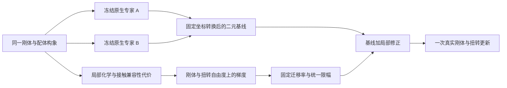

# TriCoopDiff：受保护二元基线与局部兼容性修正

更新：2026-10-05。当前`model-4.5`生产profile为`ternary_local_compatibility_v1`，
checkpoint v41，执行契约`protected_binary_local_cost_v1`。
本次是架构重构和执行验收，尚未证明验证集泛化提升。

## 设计目标与删除范围

针对训练体系拟合良好、验证集无效的问题，限制三元网络的学习职责：
保留未调制的二元专家基线，只学习局部蛋白接触和经共享配体连接的双界面兼容性。
这种归纳偏置减少全局装配记忆通路，不保证消除过拟合。

生产路径删除：三元FiLM、全局软锚点关系编码器、终态距离/精度头、距离约束求解、
交叉试探、双阶段控制器、距离辅助监督及operator更新旁路。
相应专用测试和依赖旧模块的诊断入口一并删除；历史实现从git提交恢复，实验结果保留。
仍被`legacy/trifuse.py`调用的通用特征编码器保留，不作为当前生产网络的全局分支。

## 计算路径



每步两个逻辑二元评估，打包为一轮原生专家调用。默认20步共40次二元评估。
不调用专家FiLM或内部节点特征接口，不向专家输入另一蛋白的可训练条件。
每次forward只存在一份共享配体构象，两个专家都读取该构象。
两蛋白保持刚体；配体使用已有`symmetric_horizontal_v1` torsion更新。

## 固定二元基线

共同归一化自由度为`[t_L, omega_L, t_P, omega_P, theta]`，共`12+K`维。
平移乘受体尺度`s_E/s_P`，旋转与扭转乘π；实际reverse decoder应用负时间步。
专家分数先经过既有流预条件，再对刚体建议做固定各向同性有界变换。
对得到的A、B建议，定义：

```text
prior.L.tr  = A.tr
prior.L.rot = A.rot
prior.P.rot = A.rot - B.rot
prior.P.tr  = (s_E A.tr - s_P B.tr + π(prior.P.rot × (c_P-c_L))) / s_P
prior.tor   = (tanh(A.tor) + tanh(B.tor)) / 2
```

这是确定的二元运动组合，不是两个概率分布乘积的精确联合score，也不是原始score直接相加。
无可学习专家门控。局部网络参数改变时，同一状态上的基线保持完全相同；
修正后的后续状态会自然改变专家下一次读数，这不属于专家参数调制。

## 可学习部分：局部代价

`LocalCompatibilityCorrection`只接收节点化学/序列特征、局部蛋白几何、共价图和当前坐标。
不接收体系ID、候选来源embedding、全局池化向量或真值结构。
蛋白AA和配体分类化学字段使用embedding，ESM与32维局部蛋白几何作为连续输入。
两个蛋白共用编码器与接触头；不使用蛋白角色embedding。
ESM仍含序列上下文，局部输入并不意味着完全消除了体系识别信息。

空间接触采用8 Å紧支撑Wendland C2包络，边界处至二阶导数连续：
`w(r) = max(1-r/8,0)^4 * (1+4r/8)`。
只有支持域内的PP对创建高维成对MLP特征；接触代价求和使用固定归一化，
不以全蛋白节点数稀释局部信号。

- PP项：局部跨蛋白接触的对称特征，共享标量MLP输出。
- 配体桥接项：两侧局部PL接触信息沿固定配体共价图传播，使用无向图Laplacian的`K=(I+L)^-1`构造对称双界面因子。
  不要求同一个配体原子同时接触两侧，因此允许配体两端分别结合。
  整条配体缺少任一侧接触时该项严格为零；断开共价组分不能相互桥接。

标量是学习的兼容性代价，不是校准自由能；当前没有独立标定的配体应变能。
刚体和扭转更新约束运动学合法性，不能代替化学能量模型。

## 修正动作与梯度

记上述代价为`C(x)`，真实刚体/水平扭转更新器的forward-clock Jacobian为`J(q)`。

```text
g = ∂C/∂x
r = 0.1 * J(q)^T g
m = max(四个刚体三维块的范数, 各torsion绝对值)
r_limited = r * 0.25 / (0.25 + sqrt(m^2 + 1e-12))
v = prior + r_limited
q_next = reverse_step(q, v, dt)
```

不再解距离约束或以整蛋白惯性预条件。使用固定归一化自由度度量，
统一正缩放保持局部修正自身的下降方向；混入专家后、有限步执行后不保证总cost单调下降。
每个归一化修正刚体块和每个torsion幅度小于0.25；不是整个二元基线的幅度上限。
常数cutoff=8、mobility=.1、action_limit=.25写入模型配置，checkpoint拒绝不一致。

两个代价读出末层零初始化，初始修正精确为零，输出等于固定二元基线。
真实非零读出尺度诊断在`results/model45_v41_diagnostics/local_action_scale.json`；
随机非零读出仅用于排查动作被数值缩放压没，不代表训练收益。

训练需要对cost坐标梯度继续反传，局部模块保留二阶自动微分；
`no_grad`/`inference_mode`评估中仅局部启用坐标求导，返回结果不保留训练图。
`expert_input_grad=False`固定；`expert_coordinate_grad`默认False，允许显式开启冻结专家对坐标的Jacobian，
但无论该开关为何值，专家权重和输入调制策略都不能被训练。

## 训练、数据与版本

保留已有真实初始化终点监督、可达配体目标、对称原子标签处理、近目标/恢复分支和EMA。
删除目标距离辅助损失，不新增条件Flow Matching或局部oracle模仿目标。
没有重跑用户已验证的单体系、多起点拟合实验。

数据仍使用`results/model45_partition`：6705训练、382验证，按已有来源聚类与PDB合并划分。
训练入口保留来源/索引hash审计；旧默认索引不能用于新质量对照。
每个体系只有一个真实结构；不能据此识别真实多态占比或热力学协同性。

v40及更早的生产权重不能在本模型直接resume；历史推理/复现实验使用对应git worktree。
`num_transformer_layers`和`source_conditioning`仅保留入口/来源元数据兼容意义，
新网络不构建Transformer或来源embedding，不能将来源标记解释为新模型有来源条件分支。

## 验收与边界

必要验收覆盖原生专家不受调制、每步两次逻辑读数、零修正基线、局部支持域、
配体共价桥接、SE(3)等变性、真实Jacobian、代价梯度/二阶训练、空torsion、推理模式、
checkpoint合约，以及真实冻结专家训练/采样和EMA恢复一致性。
完整CPU验收为47个文件、436项通过、0失败。真实冻结专家在`4X28_B_C_FDA`完成两次更新，
20步训练/采样终点一致、所有可训练参数梯度有限、专家权重未改变、EMA checkpoint恢复精确一致。
蛋白内部距离最大误差`5.34e-5 Å`，峰值CUDA分配约1.54 GB。
两次总损失为`11.018895`和`11.072276`，不能据此宣称收敛或质量提升。
同为node_dim=32、input_dim=1281的烟测模型，可训练state元素从v40的145221降为54946；
参数减少只描述结构规模，不是泛化证据。
最终执行记录为`results/model45_v41_smoke_final/summary.json`；smoke不是质量benchmark。

当前限制：若二元初始化和专家运动不能进入正确接触区域，局部修正不能替代全局搜索；
有限支持、配体图传播和有界修正都限制了表达能力；固定图传播在长linker上会衰减，尚未验证真实PROTAC的信号幅度。局部兼容性也不能保证无碰撞、
正确结合口袋或验证集提升。候选覆盖与泛化收益需要之后独立评估，不能由本次执行验收推出。

历史v40证据保留在`results/model45_root_cause`：距离预测改善但DockQ仍低，
是停止继续堆叠求解/控制模块的背景，不作为v41的质量结果。
