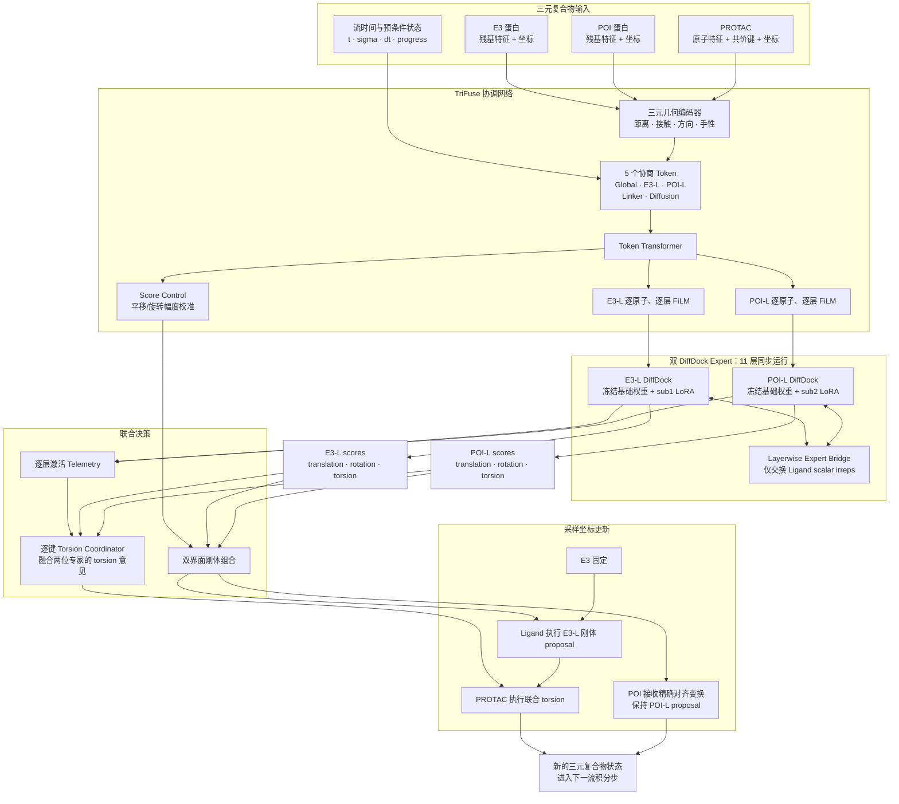

# TriCoopDiff 模型架构图

## 模块职责

- **TriFuse** 读取完整三元几何、Ligand 化学结构和流时间与预条件状态，产生两条专家路径各自的逐原子 FiLM。
- **sub1 DiffDock** 预测 E3–PROTAC 界面的平移、旋转和 torsion score。
- **sub2 DiffDock** 在 POI 局部参考系中预测 POI–PROTAC 界面，再将向量 score 映射回 E3 全局参考系。
- **Expert Bridge** 每层仅交换两路 Ligand 的标量表示，禁止跨参考系直接交换向量表示。
- **Torsion Coordinator** 按可旋转键融合两位专家的 torsion 意见，而不是固定求平均。
- **Score Control** 只校准专家 score 的幅度，不自行生成笛卡尔方向。

## 单步坐标更新

两个专家始终读取同一个更新前状态。Ligand 执行 sub1 的刚体 proposal；随后计算一个精确刚体变换，将 sub2 的 Ligand proposal 对齐到 sub1 proposal，并将同一变换施加到 POI。最后执行 TriFuse 协调后的 PROTAC torsion 更新。E3 在整个采样过程中保持固定。

该组合在 torsion 更新前精确保留两侧刚体 proposal 的 receptor–ligand 距离；随后共享 torsion 会同时改变两侧局部几何，不能把该保证延伸到完整一步之后。初始化及其精确装配见 [初始化方案_gpt6.md](初始化方案_gpt6.md)。
