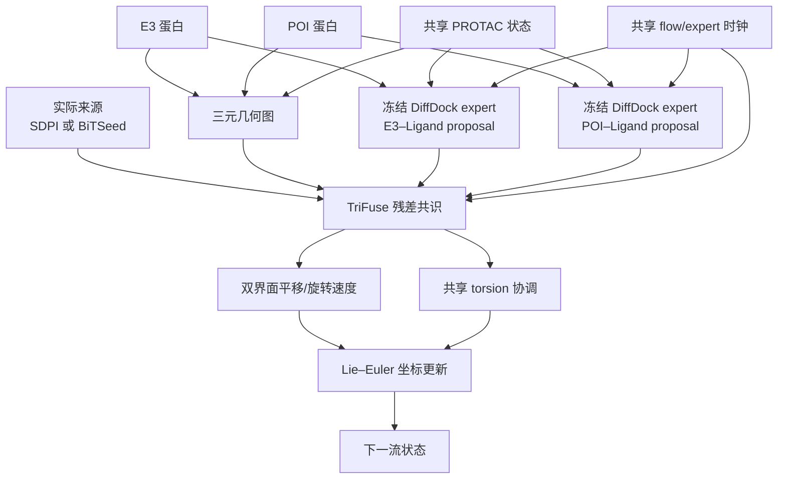

# TriCoopDiff residual-consensus-v2 架构图

## 当前职责

- 两个 DiffDock experts 加载同一预训练基座，参数始终冻结，不使用 LoRA 或 FiLM。
- 两位专家分别读取 E3–Ligand 与 POI–Ligand 二体图，产生不可直接执行的 proposal。
- `ConsensusFuse` 编码完整三元几何、两侧 proposal、扩散状态和候选实际来源。
- source conditioning 只在 C 模型启用；fallback 生成的 SDPI endpoint 必须标为 SDPI。
- 四个独立 gate 与等变 residual 共同输出两侧平移/旋转速度；torsion 只协调并应用一次。
- E3 保持固定，Ligand 与 POI 的全局姿态通过两个相对 SE(3) 状态一致重建。

## 训练与初始化

B/C 均按 `SDPI:BiTSeed = 1:1` 交替训练。训练用 BiTSeed 是 lazy `C=1, M=1`：一个
ETKDGv3 conformer、每侧专家各一条轨迹、无排序；任一专家失败时整例回退 SDPI。缓存
endpoint 经 torsion+SE(3) chart 投影后跨 epoch 复用。推理候选预算可提高到 `C=4,
M=8`，但不改变训练样本数。

## 最终模型

最终选择 source-conditioned C arm 的 epoch 81 EMA，内部 validation loss 为
`3.1384998601`。checkpoint 版本为 20，架构名为 `residual_consensus_v2`，同时保存 raw
与 EMA TriFuse，并明确记录空 expert-adapter 状态。LoRA 消融未超过该父模型，因此不在
正式训练入口或交付模型中使用。

完整训练契约和结果见
[SDPI–BiTSeed 联合训练交接](SDPI-BiTSeed联合训练交接.md)。
