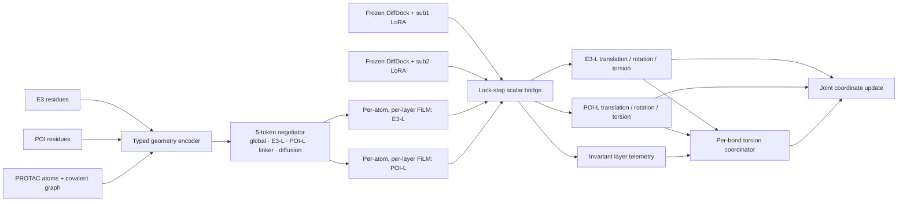

# TriFuse v13 架构与审计

> 历史文档：本文保留旧 LoRA/FiLM 设计用于审计，不代表当前交付架构。当前模型冻结
> 两个 DiffDock experts，LoRA 消融未带来收益，已明确不采用。

## 模型架构

TriFuse first encodes protein identities, ligand chemistry, covalent neighbors,
ligand-centric contacts, distance distributions, interface angles and signed
handedness. Five compact invariant tokens negotiate the two interfaces and the
physical diffusion state. They generate atom-specific scalar FiLM for each of
11 layers in each expert. The two DiffDock streams then advance in lock-step; a
zero-initialized bounded bridge exchanges only aligned ligand scalar irreps.
Independent LoRA adapters let the two interface experts specialize.

Rigid Cartesian directions always come from the equivariant experts. TriFuse
only calibrates their bounded magnitudes. A separate per-bond head combines both
torsion opinions using local bond context and current expert telemetry. During
sampling, E3 remains fixed, the ligand follows the E3-L proposal, and POI receives
the exact rigid transform that maps the POI-L proposal onto that ligand pose.

## Frames and training contract

E3 defines the global frame. The POI-L graph is rebuilt in the current POI body
frame, and its vector outputs are rotated back before use. Training uses SDPI
conditional flow paths at one shared clock and reconstructs one consistent ternary
pose. Phase 1 optimizes both interface velocity losses, joint
and auxiliary torsion losses, TriFuse, and—after warmup—branch-specific LoRA.
Judge/state heads remain frozen because no labels or losses currently exist.

## Known limitations

- Only `sdpi` is implemented. Flow endpoints match its movable-DOF prior;
  ETKDG/crystal internal-geometry mismatch remains an explicit approximation. Binary pocket/warhead
  priors and local refinement are not implemented; see [initialization](初始化方案_gpt6.md).
- Protein context uses residue-level coordinates; side-chain orientation and
  explicit backbone frames are not represented inside TriFuse.
- Hard nearest-neighbor contact selection is discontinuous when neighbors swap.
- Confidence and productive-state heads are intentionally unsupervised/frozen;
  walkers are ranked by downstream structural metrics, not learned confidence.
- Evaluation runs walkers sequentially and has no batched graph execution.
- Validation so far is structural/unit testing plus small GPU smoke runs, not a
  converged full-dataset accuracy claim.

## Non-negotiable invariants

Do not exchange vector irreps between expert frames. Do not replace non-finite
scores with zeros. Both experts must score the same pre-update ligand state, all
POI coordinates/frame metadata must receive the same rigid transform, and new
checkpoints must satisfy the exact architecture/runtime contract.
